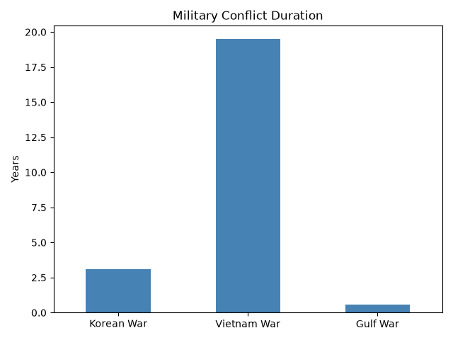

# Web Mining and Applied NLP Project Report

Web Mining and Applied NLP | Project 05 | Example Report

## Overview

This project introduces web document acquisition
and structured information extraction from HTML.

The objective is to retrieve an HTML document,
validate its structure,
extract meaningful text and metadata,
and persist the results for analysis.

The project extends the EVTL architecture
introduced in Module 4
from structured JSON API responses
to semi-structured HTML documents.

## Tools and Methods

The project uses:

- Python for pipeline orchestration and processing.
- Requests for retrieving HTML documents.
- BeautifulSoup for parsing and inspecting HTML.
- HTML selectors for locating document content.
- Validation checks for confirming required elements.
- Pandas for structured data transformation.
- CSV for persistent output.
- Logging for execution records.
- Ruff, ty, and pytest for code verification.
- Zensical and GitHub Pages for published documentation.

The example retrieves an academic paper's
abstract page from arXiv.

The pipeline implements four stages:

- **Extract** - retrieve HTML and preserve the source document.
- **Validate** - verify that required document elements exist.
- **Transform** - extract metadata and calculate derived fields.
- **Load** - save the structured results to a CSV file.

The Transform stage extracts fields including
the paper title, authors, abstract,
subject categories, and submission information.

It also calculates abstract word count
and author count.

## Verification

A successful execution displays:

    Pipeline executed successfully!

The pipeline records execution details in a project log.

The following artifacts are created:

- `data/raw/case_raw.html` - original HTML document.
- `data/processed/case_processed.csv` - extracted and transformed data.

These results demonstrate that the pipeline can
acquire, validate, extract, and persist
information from an HTML document.

Automated tests provide additional verification
of the pipeline's expected behavior.

## Interpretation

HTML documents are primarily designed
for presentation in web browsers.

Extracting structured information requires
understanding the document's elements,
attributes, and organization.

Changes in page structure can affect
validation and extraction results.

Explicit validation and transformation stages
help identify these problems
and make web mining workflows more reproducible.

The resulting structured text and metadata
provide inputs for subsequent NLP analysis.

## Documentation Index

- **Home** - this landing page
- [**Project Instructions**](project-instructions.md)
- [**Glossary**](glossary.md)

## Project Links

- [GitHub Repository](https://github.com/denisecase/nlp-05-web-documents)
- [Example Pipeline](https://github.com/denisecase/nlp-05-web-documents/blob/main/src/nlp/pipeline_web_html.py)
- [Example Configuration](https://github.com/denisecase/nlp-05-web-documents/blob/main/src/nlp/config.py)
- [Pipeline Stages](https://github.com/denisecase/nlp-05-web-documents/tree/main/src/nlp)

## Project Resources

- [Project Instructions](project-instructions.md)
- [Professional Python Guide](https://denisecase.github.io/pro-analytics-02/)
- [Professional Python Project Explainer](https://pup-pack.github.io/professional-python-project-explainer/)


## My Custom Project: Military Conflict Comparison

### Overview

For my custom project, I compared the Korean War, Vietnam War, and Gulf War. I wanted to see how long each conflict lasted and display the differences through charts and an interactive map.

### Data Sources

I used Wikipedia pages for the three conflicts:

- [Korean War](https://en.wikipedia.org/wiki/Korean_War)
- [Vietnam War](https://en.wikipedia.org/wiki/Vietnam_War)
- [Gulf War](https://en.wikipedia.org/wiki/Gulf_War)

I selected the conflict dates and map coordinates manually and used information from these pages for the comparison.

### Tools and Methods

I used Python and Requests to retrieve webpage data, BeautifulSoup to extract information, and Pandas to organize the results into a CSV file.

I calculated the duration of each conflict and used Matplotlib to create a comparison chart. I also used Plotly to build an interactive dashboard that lets users explore the conflicts.

To run the custom project:

```bash
uv run python -m nlp.pipeline_military_conflicts
uv run python -m nlp.create_chart
```

The pipeline creates `data/processed/military_conflicts.csv` and `military_conflicts_dashboard.html`. The comparison chart is saved to `docs/images/military_conflicts_chart.png`.

### Results



| Conflict | Duration |
|---|---|
| Korean War | 3.09 years |
| Vietnam War | 19.49 years |
| Gulf War | 0.57 years |

### Interpretation

The Vietnam War lasted much longer than the other two conflicts. The comparison demonstrates how differently military conflicts can develop over time.

The chart makes the differences in duration easier to understand, while the interactive dashboard provides another way to explore the conflicts and their locations.

### Limitations

I only compared three wars, and I manually selected the dates and map coordinates. Different sources may define the beginning and end of a conflict differently, which can affect the calculated durations.

Wikipedia pages also have different HTML structures, making automated data extraction more challenging.

### What I Learned and Next Steps

I learned how to collect information from multiple webpages, organize the results into a dataset, and create both static and interactive visualizations.

If I continued this project, I would compare additional conflicts, improve the automated extraction process, and add more information such as casualties and geographic regions.
